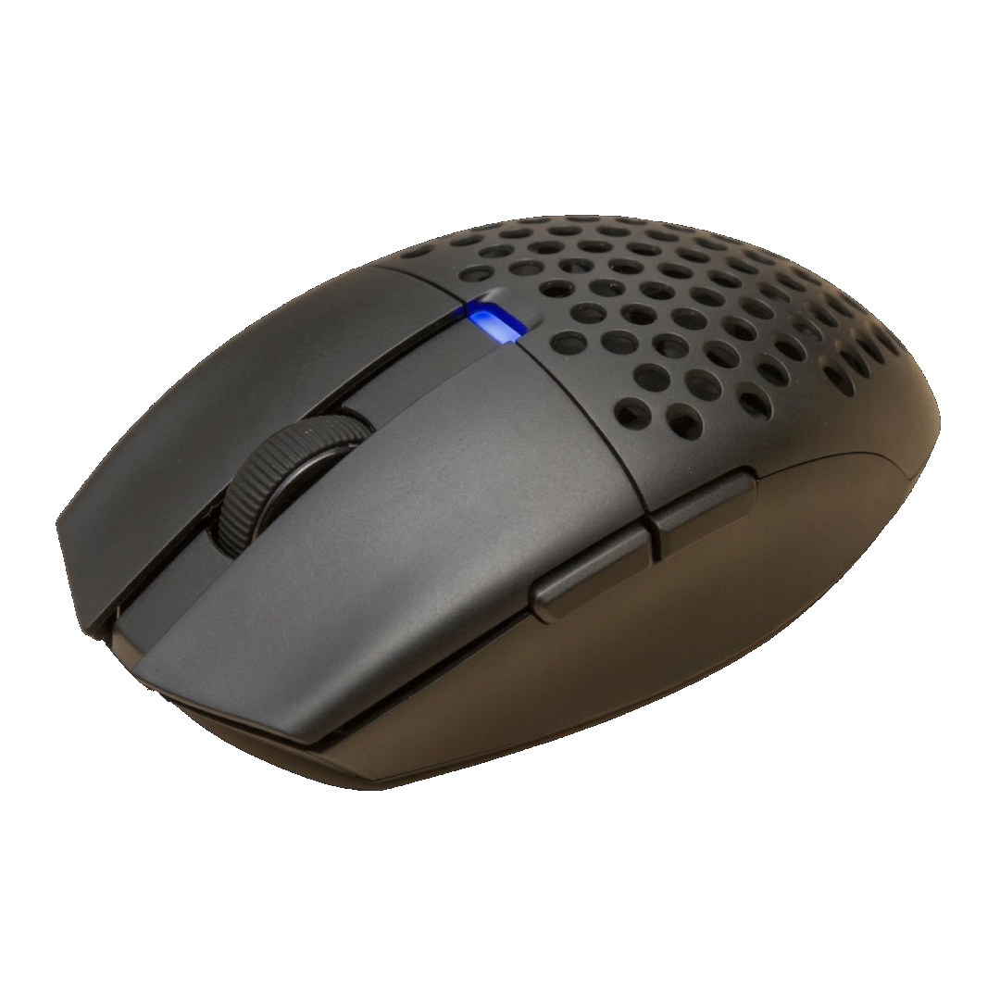

# Aria XD7 Web Config

Software konfigurasi **Fantech Aria XD7** berbasis web. Jalan langsung di browser lewat **WebHID**, tanpa install apa-apa, dan bisa dipakai di **Windows, macOS, maupun Linux**.

Software resmi Fantech cuma ada untuk Windows. Project ini mengatur semua setting mouse langsung dari browser, termasuk remap tombol.



---

## Fitur

| Kategori | Yang bisa diatur |
|---|---|
| **Performa** | Polling rate (125 / 250 / 500 / 1000 Hz), Lift-off distance (1 / 2 mm), Debounce time (0–30 ms) |
| **Fitur lanjutan** | Motion Sync, Angle Snapping, Ripple Control, Sleep timer (10 detik – 10 menit) |
| **DPI** | 1–7 stage, 50–26000 DPI (kelipatan 50), warna LED per stage |
| **Lampu** | Off / Steady (brightness 1–10) / Breathing (speed 1–5) |
| **Remap tombol** | 6 tombol (kiri, kanan, tengah, back, forward, tombol DPI), lihat daftar fungsi di bawah |
| **Macro** | **Tidak ada** — dihapus, lihat [Kenapa tidak ada macro](#kenapa-tidak-ada-macro) |
| **Koneksi** | Kabel USB atau receiver 2.4G. **Bluetooth tidak bisa** dipakai untuk setting (lihat di bawah) |
| **Battery** | Persentase battery tampil di ring kanan atas |
| **Profil** | Export / import JSON, apply ke mouse, restore default. Setting terakhir otomatis tersimpan di browser |
| **Bahasa** | Tombol bendera EN / ID di kanan atas, ikut bahasa browser, pilihan disimpan di browser |

### Fungsi yang bisa dipasang ke tombol

- **Mouse:** klik kiri, kanan, tengah, back, forward, double click, triple click
- **DPI:** DPI Loop, DPI +, DPI −, DPI Lock (DPI tetap selama tombol ditahan)
- **Keyboard:** tombol apa saja + Ctrl / Shift / Alt / Win (misal `Ctrl + C`)
- **Media:** play/pause, next, previous, volume, mute, kalkulator, browser, dll. (18 fungsi)
- **Fire key:** klik otomatis berulang
- **Lainnya:** LED on/off, ganti mode LED, disable tombol

Klik label tombol di gambar mouse, lalu pilih fungsinya. Perubahan langsung tersimpan di mouse, jadi tetap berlaku walau web ditutup atau mouse dipindah ke komputer lain.

> Minimal satu tombol harus tetap **Klik Kiri**, sama seperti aturan di software resmi.

---

## Cara pakai

### 1. Pakai browser yang mendukung WebHID

| Browser | Status |
|---|---|
| Chrome, Edge, Brave, Opera (desktop) | ✅ Bisa |
| Firefox, Safari | ❌ Tidak mendukung WebHID |
| Browser HP (Android / iOS) | ❌ Tidak bisa |

### 2. Buka halamannya

WebHID butuh *secure context*, jadi buka lewat `https://` atau `http://localhost`. Cara paling gampang:

```bash
python3 -m http.server 8000
```

Lalu buka <http://localhost:8000> di Chrome.

### 3. Connect

Colok mouse (kabel atau dongle 2.4G), klik **Connect Device**, pilih **Compx Fantech Aria XD7**, lalu klik **Connect**. Setting yang ada di mouse akan terbaca otomatis.

Kalau pakai mode wireless dan mouse sedang tidur, gerakkan mouse dulu supaya bangun.

### ⚠️ Bluetooth tidak bisa dipakai untuk setting

Lewat Bluetooth, Aria XD7 hanya membuka interface mouse dan tombol media —
jalur konfigurasinya tidak ada. Jadi setting dan remap tombol **hanya bisa
diubah lewat kabel USB atau receiver 2.4G**. Ini batasan mouse-nya, bukan
aplikasinya (driver resmi pun sama).

Setelan tersimpan di mouse, jadi atur lewat kabel/receiver, lalu geser switch
ke BT — semuanya tetap terbawa. Kalau mouse Bluetooth dipilih di Connect,
aplikasi menampilkan penjelasan ini.

Status di bawah layar menyebut jalur yang dipakai: *USB cable* (PID `0xFA7B`)
atau *2.4G receiver* (PID `0xFA7C`).

---

## Layout

- **Sebelum connect** hanya ada satu window: gambar mouse + tombol
  **Connect Device**. Begitu mouse tersambung, window mouse bergeser ke kiri dan
  window **Performance** terbuka di sebelahnya — jadi langsung kelihatan sudah connect.
- **EN / ID** di pojok kanan atas. Status koneksi (*USB cable* / *2.4G
  receiver*) dan **Diagnostics** ada di bawah tengah. Tombol **Profile**
  (import / export / apply / restore) di pojok kanan bawah.

| Window | Isi |
| --- | --- |
| **Customize** (tengah) | Baterai, gambar mouse + label tiap tombol. **Tombol DPI ada di bagian bawah mouse**, jadi garisnya putus-putus dan labelnya di bawah gambar. Logo Fantech di tengah bawah |
| **Performance** (kanan) | DPI (chip per stage + editor), Polling Rate, Lift-Off, Debounce, Sleep, Motion Sync / Angle Snapping / Ripple, Lighting |

Seluruh tampilan adalah kanvas tetap 1560×940 yang di-scale ke jendela, jadi
zoom in / out tidak menggeser apa pun.
Semua gambar memakai WebP.

### Remap tombol

Klik label tombol di gambar mouse. Semua fungsi yang dikenal firmware tersedia:

| Grup | Fungsi |
| --- | --- |
| Mouse | Klik kiri / kanan / tengah, Back, Forward, Double click, Triple click |
| DPI | DPI Loop, DPI +, DPI −, DPI Lock (nilai bebas) |
| Wheel | Scroll atas / bawah, miring kiri / kanan |
| Keyboard | Tombol apa saja + Ctrl / Shift / Alt / Win |
| Media | 18 fungsi (play/pause, volume, kalkulator, browser, …) |
| Fire key | Klik otomatis (speed + jumlah) |
| Lainnya | LED on/off, ganti mode LED, Disable |

## Bahasa (EN / ID)

Tombol bahasa ada di pojok kanan atas: bendera 🇬🇧 **EN** dan 🇮🇩 **ID**.

- Bahasa awal mengikuti bahasa browser. Browser berbahasa Indonesia langsung
  dapat halaman Indonesia, selain itu English.
- Pilihan terakhir disimpan di browser (`localStorage` key `aria_xd7_lang_v1`),
  jadi tidak perlu dipilih ulang tiap kali buka.
- Ganti kapan saja — termasuk saat masih ada notifikasi di layar, teksnya ikut berganti.
- Pintasan: <kbd>Alt</kbd> + <kbd>Shift</kbd> + <kbd>L</kbd>.

Istilah yang sudah lazim di dunia gaming (DPI, polling rate, debounce, LOD,
motion sync, slot, onboard, key down/up, delay) sengaja dibiarkan bahasa Inggris
di kedua versi, biar tetap nyambung kalau kamu baca tutorial atau software lain.
Sisanya pakai bahasa Indonesia yang santai tapi tetap jelas.

### Menambah / mengubah terjemahan

Semua teks ada di `i18n.js`. Bahasa Inggris adalah bahasa sumber: teks
Inggrisnya sendiri yang jadi key, jadi markup dan kode sudah "berisi" versi
Inggris. Untuk bahasa Indonesia cukup mengisi tabel `ID`:

- Teks statis di `index.html` diterjemahkan otomatis saat halaman dimuat,
  termasuk `placeholder`, `title`, dan `aria-label`. Isi kolom input tidak
  disentuh (itu data pengguna).
- Teks yang dibuat JavaScript dibungkus `T("...")`. Semua toast otomatis
  diterjemahkan di satu tempat (fungsi `toast()`), jadi tidak perlu dibungkus satu per satu.
- Nilai yang berubah ditulis dengan format `{nama}`, misal
  `T("Duplicated {n} times", { n: 3 })`.

Cek kelengkapan kapan saja:

```
node tools/check-i18n.js
```

Script itu memastikan setiap teks di HTML dan setiap string di `app.js` punya terjemahan, lalu keluar dengan kode error kalau ada yang bolong.

---
## Kenapa tidak ada macro

Macro Manager sempat dibuat lalu **dihapus**, karena di Aria XD7 macro tidak
bisa diandalkan dari web:

- **Menulis ulang slot macro yang sudah terisi tidak diterima mouse.** Mouse
  membalas perintah tulisnya, tapi saat dibaca balik isi slot tetap yang lama.
- **Mode eksekusi tidak cocok.** Byte mode di entri tombol (`06 slot mode`)
  tersimpan, tapi firmware Aria tidak menjalankannya seperti firmware CompX
  lain: `253` (toggle di Lamzu) membuat macro jalan terus tanpa bisa
  dihentikan, dan mode "selama ditahan" tidak jalan.

Tanpa rekaman USB dari driver resmi Windows saat mengatur macro, cara yang
benar belum diketahui. Catatan format slot yang sudah terverifikasi tetap ada
di [README-TECHNICAL.md §5](README-TECHNICAL.md#5-macro-onboard) untuk siapa
pun yang mau melanjutkan.

Kalau ada tombol yang masih terpasang macro dari percobaan sebelumnya (label
*Macro 5* dan sejenisnya), klik labelnya dan pilih fungsi lain atau **Reset
to default**.

---

## Setup khusus Linux (sekali saja)

Di Linux, device HID (`/dev/hidraw*`) defaultnya cuma bisa dibuka root, jadi browser ditolak waktu connect. Windows dan macOS nggak punya batasan ini.

Kalau web mendeteksi Linux dan connect gagal, akan muncul popup berisi perintah yang tinggal di-copy. Bisa juga langsung jalankan script ini:

```bash
./linux/install-udev.sh
```

Setelah itu **cabut-colok mouse/dongle**, lalu reload halaman. Langkah ini cuma perlu sekali per komputer.

Catatan:
- Kalau Chromium kamu versi **Snap/Flatpak** dan tetap gagal, pakai versi native karena sandbox-nya bisa memblokir akses HID.
- Detail lengkap ada di [`linux/README.md`](linux/README.md).

---

## Troubleshooting

| Masalah | Solusi |
|---|---|
| Tombol Connect nggak memunculkan apa-apa | Pastikan pakai Chrome/Edge/Brave dan dibuka lewat `localhost` / `https`, bukan `file://` |
| Device muncul tapi gagal connect (Linux) | Jalankan setup udev di atas, lalu cabut-colok mouse |
| "Mouse not responding — move it to wake it up" | Mouse wireless sedang sleep. Gerakkan mouse, setting akan terbaca otomatis |
| Battery `--` | Battery dibaca saat connect dan tiap 60 detik. Tunggu sebentar atau reconnect |
| Perubahan nggak masuk | Lihat Console (F12). Setiap perubahan dikonfirmasi oleh mouse, dan kalau gagal akan muncul pesan error |
| Device yang sama muncul dua kali | Sudah diperbaiki: daftar device disaring ke *vendor usage page*. Kalau masih muncul lebih dari satu, pilih baris yang sama dengan sebelumnya — sisanya collection mouse/keyboard biasa yang tidak dipakai |
| Muncul *The mouse did not keep 0x…* | Mouse menerima frame-nya tapi isinya tidak berubah saat dibaca balik. Artinya mouse menolak nilai itu |
| Setting tombol (mis. Wheel Up) tersimpan tapi tidak bereaksi | Setiap perubahan dibaca balik dari mouse, jadi kalau tidak ada error, nilainya memang sudah ada di mouse. Wheel/tilt berasal dari firmware CompX yang lebih baru; kalau tombolnya diam, firmware Aria belum mendukungnya |
| Mau setting lewat Bluetooth | Tidak bisa — pakai kabel USB atau receiver 2.4G (lihat bagian Bluetooth di atas) |

---

## Struktur file

```
README-TECHNICAL.md Referensi teknis: deteksi device, protokol, catatan macro
index.html          Halaman utama (kanvas tetap + tiga window + dialog Diagnostics)
i18n.js             Terjemahan EN/ID + mesin ganti bahasa
tools/check-i18n.js Cek kelengkapan terjemahan (tanpa dependency)
app.js              Protokol HID, deteksi transport, logika UI
style.css           Tampilan
button.webp         Gambar mouse untuk peta tombol  (33 KB, dari button.png 441 KB)
fantech.webp        Logo  (8 KB, dari fantech.png 223 KB)
aria_bg.webp        Background  (379 KB, dari aria_bg.png 7.7 MB)
linux/              udev rule + installer untuk Linux
battery-probe.html  Tool debug battery
testv2.html         Halaman uji coba lama
```

> File `*.png` aslinya masih disimpan sebagai sumber, tapi halaman hanya
> memuat versi WebP. Itu yang bikin halaman dulu berat: satu background PNG
> 7.7 MB sekarang jadi 379 KB, jadi load dan zoom jauh lebih ringan.

---

## Catatan teknis (untuk developer)

> Ini versi ringkas. Detail lengkap — format frame, algoritma baca macro,
> checksum, batas yang sudah terbukti dan yang masih dugaan — ada di
> **[README-TECHNICAL.md](README-TECHNICAL.md)**.

Protokolnya didapat dari sniffing USB dan analisis software resmi (`Aria_KV__XD7_Software_V1.2`), lalu dicocokkan dengan isi memori mouse asli.

### Transport

- VID `0x25A7`, PID `0xFA7B` (kabel), `0xFA7C` (receiver 2.4G). Mode Bluetooth
  (`0xFA6C`) tidak punya jalur konfigurasi.
- **OUT:** feature report `0x08`, 16 byte (aplikasi juga mencoba output
  report kalau feature report tidak dijawab)
- **IN:** input report `0x09`, 16 byte

#### Cara app memilih interface

Satu mouse bisa muncul beberapa kali di pemilih device Chrome, karena Chrome
mendaftarkan **setiap top-level collection** sebagai baris sendiri (mouse,
keyboard, consumer, vendor). Itu penyebab dulu muncul dua pilihan saat pakai
kabel.

Sekarang:

1. Pemilih device difilter ke **vendor usage page** (`0xFF00`–`0xFF07`), jadi
   cuma collection yang memakai protokol config yang muncul — satu baris saja.
2. Kalau tidak ada yang cocok, ada tombol **"Device not showing up? List all HID devices"** untuk
   menampilkan semua device HID.
3. Setiap kandidat diberi skor (`_rankDevice`): vendor page, feature/output
   report `0x08`, input report `0x09`, VID/PID. Yang skornya paling tinggi
   yang dipakai, jadi salah pilih interface tidak mungkin terjadi.

Collection mouse/keyboard biasa **tidak pernah** diambil: Chrome menyembunyikan
datanya (protected), jadi tulisannya tidak akan sampai ke mana-mana.

```
[0] cmd   [1] 0   [2..3] address (big-endian)   [4] len   [5..14] data   [15] checksum
checksum OUT = 0x4D - sum(byte 0..14)
checksum IN  = 0x4C - sum(byte 0..14)
```

| cmd | Fungsi |
|---|---|
| `0x03` | Wakeup |
| `0x04` | Minta battery → dibalas `04 00 00 00 02 <persen>` |
| `0x07` | Tulis memori → mouse mengirim echo `07 …` sebagai konfirmasi |
| `0x08` | Baca memori → dibalas `08 00 addr len data…` (maksimal 10 byte per frame) |

### Peta memori

Setiap field disimpan sebagai `nilai…, checksum`, dengan `checksum = 0x55 - sum(nilai)`.

| Alamat | Isi |
|---|---|
| `0x00` | Polling rate (1 = 1000 Hz, 2 = 500, 4 = 250, 8 = 125) |
| `0x02` | Jumlah DPI stage (1–7) |
| `0x0A` | Lift-off distance (1 / 2 mm) |
| `0x0C + i*4` | DPI stage *i*: `lo lo hi chk`. raw = `lo \| (hi>>2 & 3) << 8`, DPI = (raw+1) × 50. Contoh: 26000 = `07 07 88` |
| `0x2C + i*4` | Warna LED stage *i*: `R G B chk` |
| `0x4C` | Efek LED: `mode, ~, brightness, ~, speed, ~` |
| `0x60 + i*4` | Fungsi tombol *i* (lihat di bawah) |
| `0xA9` | Debounce (ms) |
| `0xAB` | Motion Sync |
| `0xAF` | Angle Snapping |
| `0xB1` | Ripple Control |
| `0xB5` | Sleep (1 = 10 detik … 60 = 10 menit) |
| `0x100 + i*0x20` | Data keyboard/media untuk tombol *i* |
| `0x300 + i*0x180` | Slot macro *i* (16 slot × 384 byte) |

### Encoding tombol

Urutan tombol *i*: 0 kiri, 1 kanan, 2 tengah, 3 back, 4 forward, 5 DPI.

| Byte | Fungsi |
|---|---|
| `00 00 00` | Disable |
| `01 mask 00` | Tombol mouse (mask: 01 kiri, 02 kanan, 04 tengah, 08 back, 10 forward) |
| `02 01/02/03 00` | DPI Loop / DPI + / DPI − |
| `04 32 02` / `04 32 03` | Double / triple click |
| `04 speed times` | Fire key |
| `05 00 00` | Keyboard/media, data event-nya ada di `0x100 + i*0x20` |
| `06 slot mode` | Macro onboard (dari driver resmi; tidak diatur oleh aplikasi ini) |
| `03 01/02 00` | Wheel miring kiri / kanan |
| `0B 01/02 00` | Scroll atas / bawah |
| `07 00 00` / `08 00 00` | Ganti mode LED / LED on-off |
| `0A raw 00` | DPI Lock |

Format blok data keyboard/media: `jumlah_event, (op, lo, hi)…, checksum`

| op | Arti |
|---|---|
| `80` / `40` | Tekan / lepas modifier (1 Ctrl, 2 Shift, 4 Alt, 8 Win) |
| `81` / `41` | Tekan / lepas tombol keyboard (kode HID usage) |
| `82` / `42` | Tekan / lepas tombol media (HID consumer usage) |

---

## Disclaimer

Project ini **tidak berafiliasi** dengan Fantech. Semua setting ditulis ke memori mouse, jadi gunakan dengan risiko sendiri. Kalau ada yang aneh, pakai **Restore Defaults** dari menu ☰.

Made by **Eben**, created with love ♥ · [tako.id/hnxzl](https://tako.id/hnxzl)
